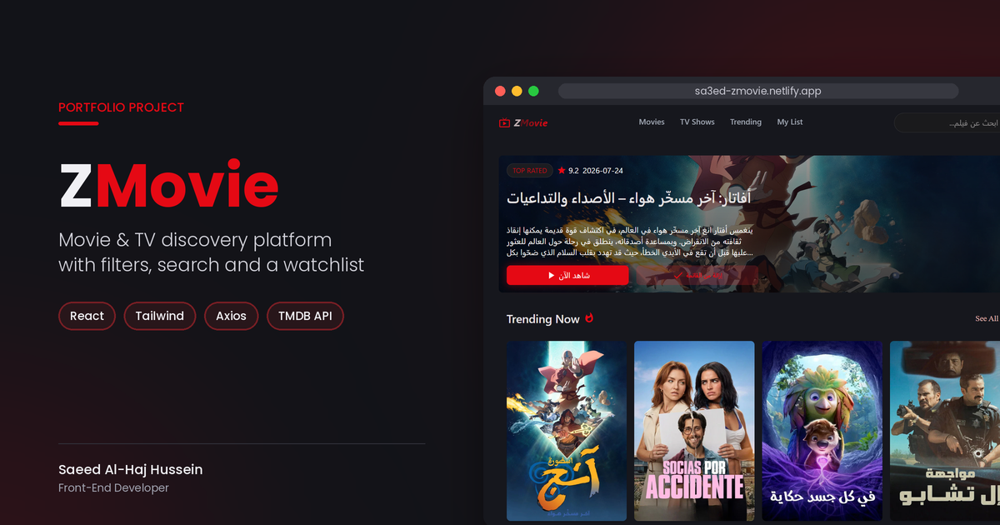

# 🎬 ZMovie

A fast, responsive movie & TV discovery website. Browse, filter, watch trailers and save titles to your own watchlist, powered by the TMDB API.

[](https://sa3ed-zmovie.netlify.app/)



## ✨ Features

- **Home page** with a hero banner for the newest release in theaters and a **Trending Now** section
- **Movies & TV Shows** pages with filtering tabs (Now Playing, Popular, Top Rated, Upcoming / Airing Today, On The Air, Popular, Top Rated)
- **Trending** page with this week's most popular movies and shows
- **Search** across movies and TV shows, with filters for **genres, year, rating and original language** and sorting
- **Discover mode**: open the search page without a query to browse movies with server-side filters
- **Watch Trailer**: plays the official YouTube trailer in a modal (the button is hidden when a title has no trailer)
- **Details page** for movies and TV shows: rating, year, runtime, genres, storyline, **top cast** with photos and **similar titles**
- **Watchlist** saved in Local Storage, so it persists between visits
- **Pagination** on every list
- Loading skeletons, friendly error and empty states
- **Responsive design** from 375px phones to wide desktops, with no hover-only actions on touch devices

## 🛠️ Tech Stack

| Category      | Technology                                    |
| ------------- | --------------------------------------------- |
| UI library    | React 19                                      |
| Build tool    | Vite 8                                        |
| Styling       | Tailwind CSS 4                                |
| UI components | Material UI 9 (MUI) + MUI Icons, Emotion      |
| Routing       | React Router 7                                |
| HTTP client   | Axios                                         |
| Data          | [TMDB API](https://developer.themoviedb.org/) |
| Linting       | ESLint 10                                     |
| Hosting       | Netlify                                       |

## 🚀 Getting Started

```bash
git clone https://github.com/Sa3ed-031/zmovie.git
cd zmovie
npm install
cp .env.example .env   # then add your TMDB API key (see below)
npm run dev
```

The app runs at `http://localhost:5173`.

### 🔑 Environment variables

ZMovie needs a free TMDB API key:

1. Create a free account at [themoviedb.org](https://www.themoviedb.org/signup).
2. Go to **Settings → API** ([direct link](https://www.themoviedb.org/settings/api)) and request an API key.
3. Copy `.env.example` to `.env` and paste your key:

```env
VITE_TMDB_API_KEY=your_tmdb_api_key_here
```

`.env` is git-ignored, so your key is never committed. When deploying to Netlify, add the same variable under **Site configuration → Environment variables**.

## 📜 Attribution


This product uses the TMDB API but is not endorsed or certified by TMDB.

## 👤 Author

**Saeed Al-Haj Hussein**, Front-End Developer

- LinkedIn: [sa3ed-al-haj-hussein](https://www.linkedin.com/in/sa3ed-al-haj-hussein/)
- GitHub: [Sa3ed-031](https://github.com/Sa3ed-031)
- Portfolio: [sa3ed-portfolio.netlify.app](https://sa3ed-portfolio.netlify.app)
- Email: [saeedalhajwork@gmail.com](mailto:saeedalhajwork@gmail.com)

<p align="center">💼 Need a website for your business? <a href="mailto:saeedalhajwork@gmail.com">Let's talk!</a></p>
